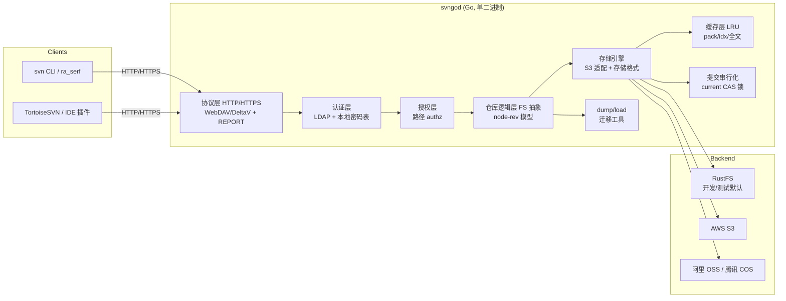

# Go 版 SVN 服务器（svngod）架构设计方案

> 版本：v1.1　|　日期：2026-10-28　|　状态：待评审（已并入 owner 规模决策）
>
> 目标：用 Go 从零重写一个 SVN 服务器，**对 `svn` 客户端原生支持 HTTP/HTTPS 协议（WebDAV/DeltaV）**，**认证支持 LDAP 与本地密码表双通道**，**版本数据全部存储于标准 S3 兼容对象存储**（MinIO / AWS S3 / 阿里 OSS / 腾讯 COS 等），并支持存量仓库经 `svnadmin dump/load` 格式迁移。

---

## 目录

1. [项目概述与目标](#1-项目概述与目标)
2. [总体架构](#2-总体架构)
3. [协议层设计（SVN-over-HTTP / WebDAV / DeltaV）](#3-协议层设计)
4. [认证与授权层](#4-认证与授权层)
5. [S3 版本存储引擎](#5-s3-版本存储引擎)
6. [数据迁移（dump/load）](#6-数据迁移)
7. [一致性、并发与性能](#7-一致性并发与性能)
8. [工程结构与技术选型](#8-工程结构与技术选型)
9. [部署与运维](#9-部署与运维)
10. [风险、权衡与路线图](#10-风险权衡与路线图)
11. [开放问题](#11-开放问题)

---

## 1. 项目概述与目标

### 1.1 背景与动机

现网 SVN 依赖 Apache HTTPD + `mod_dav_svn`（C 实现），其协议接入层（WebDAV/DeltaV）与存储层（FSFS）与 Apache 深度耦合，难以弹性扩展、容器化与对象存储化。本项目用 Go 重写，目标是把协议层、认证层、存储层彻底解耦，并把版本数据落到**标准 S3 对象存储**上，获得弹性、低成本、跨云可移植的存储底座。

### 1.2 明确的目标（Goals）

| 编号 | 目标 |
|---|---|
| G1 | 对 `svn` 客户端（ra_serf/HTTP 访问层）提供**原生 HTTP/HTTPS** 接入，兼容 `svn` CLI、TortoiseSVN、IDE 插件等标准客户端，无需任何客户端改造 |
| G2 | 完整兼容 SVN 功能语义：checkout / update / commit / log / diff / blame / merge / 分支 / 标签 / properties / copy / move / delete / 锁定 / 路径授权（authz） |
| G3 | 认证支持 **LDAP**（bind 或 search+bind）与**本地密码表**双通道，可配置先后次序 |
| G4 | 版本数据全部存储于**标准 S3 API** 对象存储，单仓库单实例即可部署，开发/测试用 S3 兼容后端采用 **RustFS**（亦兼容 AWS S3 / 阿里 OSS / 腾讯 COS） |
| G5 | 支持存量仓库经 **`svnadmin dump/load` 格式**迁移，提供配套 admin CLI |
| G6 | 单二进制交付，容器化友好，TLS 原生支持 |
| G7 | **单仓支撑 1000 万修订**量级（已确认规模目标），存储引擎按"分片 + 封装"设计，对象数可控 |

**已确认规模目标（owner 拍板）**：单仓库修订数上限 **1000 万**；部署形态 **单进程单实例**；LDAP 采用 **OpenLDAP**，authz 组定义在**本地 authz 文件**（不从 LDAP 动态解析）；验收客户端 **全覆盖**（svn CLI + TortoiseSVN + IDE 插件）。

### 1.3 非目标（Non-Goals）

- 不实现 `svnserve`（svn://）协议（仅做 HTTP/HTTPS）。
- 不直接读取/兼容现有 FSFS 仓库文件（迁移走 dump/load，见第 6 节）。
- 不追求与 Apache 的 `mod_*` 配置语法兼容（提供自有 YAML 配置）。
- **不做多实例多活**（单进程单实例部署；`current` CAS 机制保留为未来横向扩展的预留能力，但首期不启用多实例）。

### 1.4 关键设计原则

1. **不可变对象 + 原子指针**：S3 对象不可部分更新/追加写，因此所有版本数据以"不可变对象"形式写入，仅通过一个 `current` 指针做原子推进，天然契合 S3 的一致性模型（新对象读后写一致性）。
2. **协议层与存储层彻底解耦**：协议层只面向"仓库逻辑接口"（FS 抽象），存储层只负责对象读写，两处可独立演进与测试。
3. **缓存决定性能**：S3 单次往返数十毫秒，必须用本地缓存（内存 LRU + 可选磁盘）吸收热点读取，避免逐对象打满 S3。
4. **以 svnadmin verify / dump 往返为验收基准**：任何格式改动必须通过 checksum 级校验。

---

## 2. 总体架构



**请求主链路**：客户端 HTTP 请求 → 协议层路由（按 DAV 方法 / REPORT 分派）→ 认证 → 授权 → 仓库逻辑层（构造响应，读写 node-rev）→ 存储引擎（命中缓存则免 S3 往返，否则 Range GET / PUT）→ 返回响应。

**写链路（提交）**：客户端经 MKACTIVITY/CHECKOUT/PUT/DELETE/…/MERGE 将变更暂存到事务 → 提交时经 `current` CAS 原子推进 → 以松散修订对象写入**当前分片**（满片后由后台封装为 `revs/<shard>.pack`）。

---

## 3. 协议层设计

### 3.1 协议定位

`svn` 客户端的 HTTP 访问层（ra_serf）使用 **WebDAV（RFC 4918）** 的子集 + **DeltaV（RFC 3253）** 扩展，并叠加 SVN 自定义方法/头。服务器必须精确复刻 `mod_dav_svn` 的行为，客户端才对判定严格（错误响应体、状态码、XML 命名空间都需一致）。

### 3.2 需要实现的 HTTP 方法

| 方法 | 用途 | 说明 |
|---|---|---|
| `OPTIONS` | 能力协商 | 声明 `DAV: version-control, checkout, working-resource, merge, ...` |
| `PROPFIND` | 取目录/文件 + 属性；也是 update 的核心 | 深度、`svn:fetch` 自定义报告、`version-tree` |
| `PROPPATCH` | 修改属性（含 `svn:` 属性） | |
| `MKACTIVITY` | 创建活动（活动即事务的容器） | 提交的第一步 |
| `CHECKOUT` | 在工作资源/活动下检出 VCR | 建立可写的工作资源 |
| `CHECKIN` | 触发提交固化 | mod_dav_svn 以 CHECKIN 触发 MERGE 提交 |
| `MERGE` | 真正执行提交（把活动内容合并为修订） | 服务器在此序列化并原子落盘 |
| `GET` | 取文件内容 | 支持 Range |
| `PUT` | 上传文件内容（svndiff 增量或全文） | |
| `DELETE` / `MKCOL` / `COPY` / `MOVE` | 删除 / 建目录 / 复制 / 移动 | 作用于工作资源或版本树 |
| `REPORT` | 自定义报告 | `get-locations`、`get-location-segments`、`get-file-revs`、`get-dated-revision`、`get-mergeinfo` 等 |

### 3.3 自定义扩展与头

- 头：`SVN-Depth`、`SVN-Repository`、`X-SVN-Version`、`X-SVN-Session-Checksum`、`SVN-SVNDIFF`、`X-SVN-Svndiff-Accept`、`DAV: version-control` 等。
- 属性：`svn:wc:…`、`svn:entry:…`、`version-name`、`checked-in`、`creator-displayname`、`svn:author/date/log` 等标准 SVN 属性。
- 文本增量：客户端以 **svndiff 二进制增量**上报，需 `internal/svndiff` 编解码支持（见 5.5）。

### 3.4 提交时序（DeltaV 模型）

1. `MKACTIVITY` → 服务器创建活动 UUID，映射到存储层事务 `txn/<txid>/`。
2. `CHECKOUT` 仓库根 VCR → 在工作资源下建立可写副本。
3. 对每个变更路径执行 `DELETE`/`MKCOL`/`COPY`/`MOVE`（目录结构变更）与 `PUT`/`PROPPATCH`（内容与属性变更），全部写入活动对应的事务暂存区。
4. `CHECKIN`（触发 `MERGE`）→ 服务器串行化提交：合并暂存变更 → 写松散修订对象 `revs-loose/<shard>/<N>` → CAS 推进 `current` → 生成新修订（分片满后由后台封装，见 5.2）。
5. 成功后清理活动/事务；失败则回滚暂存并返回错误。

**协议层要点**：每个方法都要正确处理 `SVN-Depth`、响应体 XML 命名空间（`DAV:` / `SVN:`）、以及 `405/409/423` 等标准错误语义，保证 TortoiseSVN 等客户端可正常操作。

### 3.5 读链路（checkout / update）

- checkout/update 通过 `PROPFIND` + `svn:fetch` 报告一次性拉取目标目录子树（含每个条目的 `checked-in` 版本、属性、文本校验和），客户端据此构建工作副本；文件内容随后用 `GET` 按需拉取。
- 需支持 `REPORT` 的 `update-report`/`get-locations` 等，用于 `svn update` 的增量与历史定位。

---

## 4. 认证与授权层

### 4.1 传输层认证

采用 **HTTP Basic**（`Authorization: Basic base64(user:pass)`），由 HTTPS/TLS 保证传输安全（svn 客户端默认仅对 HTTPS 发送凭据）。会话侧可选基于内存的短时令牌缓存，减少 LDAP 往返。

### 4.2 认证链（Authn Chain）

按配置顺序尝试，命中即通过：

```yaml
auth:
  order: ["local", "ldap"]   # 或 ["ldap", "local"]
```

1. **本地密码表**（`local`）
   - 兼容 SVN `passwd` 文件与 Apache `htpasswd` 两种形态，支持明文透传与哈希（`{SHA}`、`bcrypt`、`argon2id`）。
   - 用户条目以**哈希**存储为准；明文仅用于兼容迁移期，启动时告警。
   - 支持加载重载（SIGHUP / 轮询 mtime），改密不重启。
2. **LDAP**（`ldap`）
   - `go-ldap/v3`。两种模式：
     - **search+bind**：用服务账号在 `base_dn` 下按 `user_filter`（如 `uid=%s`）定位用户，再用该用户 DN 绑定时校验口令（推荐，避免泄露用户 DN 规则）。
     - **direct bind**：用 `cn=%s,base_dn` 直接绑定校验（简单，需 LDAP 允许）。
   - 配置：`url`、`tls`（startTLS/LDAPS）、`base_dn`、`user_filter`、`bind_dn`/`bind_password`（服务账号）、`group_filter`（可选，供授权组解析）。

### 4.3 授权层（Authz）

- 兼容 SVN **authz 文件格式**：`[groups]`、`[/]`、`[/path]`、`@group = r/w`、`* = r`、`~` 排除规则、继承与覆盖语义。
- 实现 `internal/authz`：解析 + 最长前缀路径匹配 + 组解析（组可来自 authz 静态定义或 LDAP 动态组）。
- 每个请求按（用户，路径，操作 read/write）做判定；目录操作需校验整条路径可达性。

### 4.4 安全设计

- 口令绝不落日志；认证失败统一返回 401 且不泄露"用户是否存在"。
- Basic 凭据仅限 TLS 通道；提供 TLS 强制开关。
- LDAP 连接复用、超时与故障降级（LDAP 不可用时按策略 fail-open/fail-closed，默认 fail-closed 并告警）。

---

## 5. S3 版本存储引擎

这是本方案的技术核心：S3 对象**不可部分更新、无追加写、新对象读后写一致**，与 FSFS"可随机读写的追加式仓库"模型截然不同。叠加**单仓 1000 万修订**的规模约束后，"每修订一对象"会膨胀到约 3000 万对象/仓，必须改为 **分片（shard）+ 封装（pack）** 的模型（吸收 FSFS 的 shard/pack 思想，适配 S3 的不可变对象）。

### 5.0 规模约束与设计目标

| 规模事实 | 影响 |
|---|---|
| 单仓修订数 ≤ 1000 万 | 若每修订 3 个对象（rev + idx + revprops）→ 约 3000 万对象/仓，对象数、元数据、成本失控 |
| S3 单对象不可追加/部分更新 | 不能像 FSFS 那样"追加写一个修订文件" |
| S3 新对象读后写一致 | 数据对象先于指针可见，即可保证原子提交 |
| 单次 S3 往返数十毫秒 | 必须以缓存 + Range 读吸收，禁止逐对象打满 S3 |

**结论**：按"修订分片 + 分片内松散对象 + 满片封装为单个 pack 对象"设计，1000 万修订可收敛到约 **2500 个包对象**（SHARD_SIZE 取 4096 时），对象数从千万级降到万级，同时保持"每修订一个不可变写入单元"的原子性。

### 5.1 对象布局（单仓库，分片模型）

```
<repo>/                          # 仓库根（一个 bucket 前缀 或 一个 bucket）
  format                         # 存储格式版本（小对象，一次性写入）
  uuid                           # 仓库 UUID
  current                        # HEAD 指针：`HEAD=<N>\n` + 校验（CAS 目标）
  revs/<shard>.pack              # 已封装修订分片：该分片所有修订的 node-rev 打包（不可变）
  revs/<shard>.idx               # 分片索引：(rev, node-rev-id) → (offset,length)，Range 随机访问
  revprops/<shard>.pack          # 该分片全部修订的属性（author/date/log…）打包
  revs-loose/<shard>/<N>         # 活跃分片内的松散修订对象（未封装，当前正在写入）
  revprops-loose/<shard>/<N>     # 活跃分片内的松散修订属性
  txn/<txid>/…                   # 进行中事务（活动）的暂存区
  locks/<path-hash>              # 文件锁对象
  dav-activities/<uuid>          # 活动(DeltaV activity)→事务的映射
```

- **shard = N / SHARD_SIZE**；`SHARD_SIZE` 可配置，1000 万规模建议 **4096**（约 2442 个分片；可调大如 10000 进一步降对象数，换取单 pack 体积增大）。
- 同一时刻仅**当前活跃分片**存在松散修订对象（≤ SHARD_SIZE 个），历史分片均为已封装 pack 对象。

### 5.2 写路径（一次原子提交）

1. **暂存**：客户端变更写入 `txn/<txid>/` 下的 node-rev 对象（不可变，随写随固）。
2. **固化**（MERGE 触发）：
   - 加提交锁（见 5.6）→ 串行化。
   - 把事务中所有 node-rev 序列化为**松散修订对象** `revs-loose/<shard>/<N>`（一个 PUT）+ 写 `revprops-loose/<shard>/<N>`（一个 PUT）。
   - **原子推进** `current`：条件 PUT（`If-Match: <current 当前 ETag>`），把 `HEAD=N-1` 换成 `HEAD=N`。
   - 成功 → 清理事务与活动；失败 → 回滚暂存，孤儿对象交给 GC（见 5.7）。
3. **封装（后台）**：当前分片写满 SHARD_SIZE 时，后台任务把该分片全部松散修订合并为 `revs/<shard>.pack` + `revs/<shard>.idx` + `revprops/<shard>.pack`，随后该分片的松散对象转为不可达，由 GC 回收。封装期间读写不受影响（读路径按 5.3 逻辑自动命中松散或封装对象）。

> 关键正确性：**数据对象先于指针可见**。即使崩溃在"写了松散修订但未推进 current"之间，`current` 仍指向 N-1，孤立的松散对象会被 GC，仓库一致性不受破坏。`current` 的 CAS 同时充当**提交串行化点**，天然满足 SVN"修订号线性递增"的要求。

### 5.3 读路径与随机访问

- 定位：`shard = N / SHARD_SIZE`。
  - 活跃分片：读 `revs-loose/<shard>/<N>` 对象。
  - 历史分片：读 `revs/<shard>.idx`（缓存）→ 定位 node-rev → Range 读 `revs/<shard>.pack` 对应字节段。
- 文件全文重构：若 node-rev 存的是 svndiff 增量，沿 base 链向上读取基文本 + 逐段应用 delta。命中缓存则免 S3 往返。
- **增量链可跨分片**：base 链可回溯到更早分片，故 5.4 的 deltification 与全文缓存对 1000 万规模尤为关键。
- 缓存设计（见 5.6）：热点 `idx`、`pack` 段、重构后的全文，按 LRU 驻留内存。

### 5.4 增量与 deltification 策略

- 首次写以**全文**落盘；后续写以**svndiff 增量**落盘（基为上一修订同路径）。
- 增量链长度设上限（如 `MAX_DELTA_CHAIN=64`），超过则触发**重写为全文**（deltification）。1000 万修订下这是**必选项**：不控制链长，HEAD 处读一个文件全文可能回溯跨数千个分片、数百次 S3 往返。
- 文本/属性均带 **MD5/SHA-256 校验和**，校验和随 node-rev 存，读时验证（与 `svnadmin verify` 语义对齐）。

### 5.5 svndiff 编解码

- SVN 使用自研二进制增量格式 **svndiff**（窗口式，含 `SVN_FS_FS_DELTA` 封装）。需实现 `internal/svndiff` 的 encode + decode：
  - decode：重构客户端上报增量、读历史全文。
  - encode：dump-load 落库、deltification 重写。
- 以 `svn` 官方生成的样本往返校验（encode→decode 恢复原文本，字节级一致）。

### 5.6 缓存与提交串行化

- **缓存层**（`internal/cache`）：内存 LRU（默认 1 GiB，可配）+ 可选本地磁盘缓存（默认关闭，按部署可开，如 `/var/cache/svngod`），缓存键为 `(repo, rev, node-rev-id)`、`(repo, shard)` 分片 idx、`(repo, path, rev)` 重构全文。并发安全。
- **提交锁**：单进程部署下以**进程内互斥**为主 + `current` 条件 PUT（CAS）为硬保证（双保险）。`current` CAS 本身即线性化点，为未来多实例预留（首期不启用）。
- 缓存命中率是 1000 万规模下性能的**第一指标**，P4 阶段按该指标压测调优。

### 5.7 垃圾回收（GC）

- 孤儿对象来源：崩溃残留的 `txn/`、未推进的孤立松散修订、被封装后转为不可达的 `revs-loose/*`、被 deltification 重写的旧链。
- GC 策略：后台扫描 + 引用标记（以 `current` 与各 `revs/<shard>.idx` 为根），标记-清扫不可达对象。低优先、可断点续跑，不做在线热点路径。
- 1000 万规模下，GC 的**对象清单列举**（ListObjects）可能较慢，采用前缀分片 + 游标续列，以分片为单位批量处理。
- 兼容弱一致 S3：GC 只删"确定不可达"对象，删除/覆盖一致性问题不影响正确性（根数据均不可变）。

### 5.8 与 S3 一致性模型的匹配（为何可行）

| S3 特性 | 本设计如何规避 |
|---|---|
| 新对象读后写一致 | 所有版本对象为"新对象创建"，且先于 `current` 指针可见 |
| 覆盖/删除可能最终一致 | 仅 GC 涉及删除；根数据不可变，弱一致无碍正确性 |
| 无部分更新/无追加写 | 用"松散修订对象 + 满片封装 + 原子 current 指针"替代 FSFS 追加写 |
| 单次请求开销高 | 本地缓存 + Range 读 + 分片索引，降低 S3 往返 |
| 千万级对象管理成本 | 分片封装把对象数从千万级降到万级 |

---

## 6. 数据迁移

### 6.1 dump/load 格式支持

- 实现 SVN **转储格式读取器**（兼容 `SVN-fs-dump-format-version: 1~3`）：
  - 头部：`SVN-fs-dump-format-version`、`UUID`。
  - 修订段：`Revision-number`、修订属性（`Prop-content-length`/`Content-length`）。
  - 节点段：`Node-path`、`Node-kind`、`Node-action`、`Node-copyfrom-rev/-path`、`Node-content-length`、`Text-content-length`、`Text-content-md5`、`Prop-content-length`、`Text-delta`，以及属性增量/文本增量内容。
- 支持 **全文与增量（--deltas）两种 dump** 的读入。
- 加载器把节点逐段应用到存储引擎（写 node-rev、推进 `current`），保证加载后可用 `svnadmin verify` 语义校验。

### 6.2 admin CLI（`svngod-admin`）

```
svngod-admin create --config repo.yaml <repo>     # 建仓（写 format/uuid/current）
svngod-admin dump <repo> <path.dump> [--range A:B] [--deltas]
svngod-admin load <repo> <path.dump>              # 全量/增量加载
svngod-admin info <repo>                          # 仓库信息/校验
svngod-admin gc   <repo>                          # 触发垃圾回收
```

- 迁移链路：`svnadmin dump 旧仓 > repo.dump` → `svngod-admin create` → `svngod-admin load repo.dump` → `svn update/checkout` 验证。
- 支持**增量迁移**（按修订区间 dump/load），方便大仓库分批迁移。

### 6.3 校验

- 加载后对关键修订做 `Text-content-md5` 复算校验。
- 提供 `svngod-admin verify`：逐修订检查 node-rev 校验和、`current` 一致性、链完整性。

---

## 7. 一致性、并发与性能

### 7.1 一致性

- **提交原子性**：`current` CAS 保证单次提交要么完全可见、要么完全不可见。
- **修订线性化**：修订号严格递增，与 SVN 语义一致（一个修订 = 一次原子提交）。
- **读一致性**：单请求读取基于固定 `current` 快照，避免读到半提交状态。

### 7.2 并发

- **单进程单实例**（已确认）：进程内互斥 + `current` CAS 双保险；读路径无锁（只读缓存 + 不可变对象）。
- 多实例为**预留能力**：`current` CAS 本身即线性化点，但首期不启用、不承诺多活。
- **路径级 CAS / 交错提交**（已落地）：HTTP 层对每个仓库维护 **per-repo 单例 `Repo`**（共享 `r.mu`），提交经 `r.mu` 串行化后仍以**路径级 out-of-date 检查**判定：
  - **不同路径并发提交 → 全部成功**，成为连续修订（对齐标准 SVN 的交错提交）。
  - **同路径并发 → 1 胜 + N-1×`E160024`**（拒绝陈旧事务，不静默覆盖）。
  - 检查逻辑：对每个变更的 `path`（跳过根/目录），若其在 `baseRev..HEAD` 窗口内被另一提交修改（HEAD 版 node-rev 修订号 > baseRev，或被并发删除）→ 拒绝；目录级变更不参与（避免把子路径的正常演进误判为冲突）。实测：5 个 WC 并发提交独立文件 5/5 成功（HEAD 65→70），3 个 WC 并发改同文件 1 胜 2 败。

### 7.3 性能要点

- 缓存吸收热点：目录列表、`idx`、常用全文。
- Range 读按需取字节，不整对象拉取。
- 批量索引合并：一个 `REPORT`/`PROPFIND` 只做有限次 S3 往返。
- 预热：部署后按热路径预热缓存。
- **1000 万修订专项**：log / blame 等历史重操作天然昂贵，必须分页 + 走缓存 + 并行 Range 读；`current` / HEAD 访问始终 O(1)。

---

## 8. 工程结构与技术选型

### 8.1 目录结构（Go 工程）

```
svngod/
  cmd/
    svngod/            # 服务器入口
    svngod-admin/      # admin CLI
  internal/
    config/            # YAML 配置加载与校验
    protocol/          # HTTP 路由、DAV 方法、REPORT、错误语义
    auth/              # authn：local + ldap + 认证链
    authz/             # authz：SVN authz 文件解析与路径匹配
    fs/                # 仓库逻辑层：node-rev 模型、FS 抽象
    fs/store/          # 存储引擎：S3 适配 + 存储格式
    svndiff/           # svndiff 编解码
    dump/              # dump/load 读写器
    cache/             # LRU 缓存
    lock/              # 提交串行化（current CAS / 锁对象）
    observability/     # 日志/指标/健康检查
  configs/             # 示例配置
  test/                # 集成测试（对真实 svn 客户端）
```

### 8.2 依赖选型

| 用途 | 选型 | 说明 |
|---|---|---|
| HTTP 服务器 | `net/http`（stdlib） | 单二进制、TLS 原生 |
| S3 客户端 | `minio-go/v7`（或 aws-sdk-go-v2） | 经 endpoint 定制兼容 RustFS/MinIO/AWS/OSS/COS |
| LDAP | `github.com/go-ldap/ldap/v3` | search+bind、TLS、组查询 |
| 口令哈希 | `golang.org/x/crypto`（bcrypt/argon2） | 本地密码表哈希 |
| UUID | `github.com/google/uuid` | 活动/事务 ID |
| 配置 | `gopkg.in/yaml.v3` | 配置解析 |

> 说明：S3 客户端优先 `minio-go`，其对 RustFS/MinIO/AWS/阿里 OSS/腾讯 COS 的 endpoint 与签名（v2/v4）兼容性最好，可一套代码覆盖多家（对应需求 G4 的"兼容多家"）。开发/测试默认后端为 **RustFS**（`rustfs server <datadir> --address 127.0.0.1:9000`，path-style 访问），S3 集成测试在 RustFS 上实跑全通过。

---

## 9. 部署与运维

### 9.1 部署形态

- 单二进制 + 一个 YAML 配置，容器化（提供 Dockerfile / K8s deployment 示例）。
- TLS 由 Go 原生 `http.Server` 终结（证书路径配置），或前置 LB 终结后内部 HTTP。

### 9.2 配置示例（示意）

```yaml
server:
  listen: ":443"
  tls:
    cert: /etc/svngod/tls.crt
    key:  /etc/svngod/tls.key
  auth_required: true

storage:
  s3:
    endpoint: "127.0.0.1:9000"   # 开发默认 RustFS（rustfs server）
    access_key: "…"
    secret_key: "…"
    bucket: "svn-repos"
    region: "us-east-1"
    use_ssl: true
    # AWS / 阿里 OSS / 腾讯 COS 通过切换 endpoint 与签名即可
  format:
    shard_size: 4096          # 每分片修订数（1000 万规模建议 4096，可调大降对象数）
    max_delta_chain: 64       # 增量链上限，超过触发 deltification
  cache:
    memory_bytes: 1073741824  # 内存 LRU 1GiB
    disk_dir: ""              # 磁盘缓存，默认关闭

auth:
  order: ["local", "ldap"]
  local:
    passwd_file: /etc/svngod/passwd        # svn passwd / htpasswd
  ldap:
    url: "ldaps://ldap.example.com:636"
    base_dn: "ou=people,dc=example,dc=com"
    user_filter: "(uid=%s)"
    bind_dn: "cn=svc,ou=svc,dc=example,dc=com"
    bind_password: "…"

authz:
  authz_file: /etc/svngod/authz            # SVN authz 格式

repos:
  root: /repos                              # 仓库根映射：URL 路径 → 仓库
```

### 9.3 可观测性

- 结构化日志（slog）；指标（Prometheus）：请求量/延迟/缓存命中率/S3 往返数/提交延迟。
- 健康检查 `/healthz`、`/readyz`。

### 9.4 多仓库与多后端（多库架构，已落地）

除单仓库模式（命令行 flag）外，svngod 支持以 JSON 配置文件启动**单进程多库**，每库在存储、授权与认证上完全独立（`--config svngod.json`）：

```json
{ "addr": "127.0.0.1:19993", "base-path": "/svn",
  "repos": [
    { "name": "demo",  "storage": { "type": "file", "root": "/srv/svn/repos" },
      "authz": "/etc/svngod/authz-demo",
      "auth": [ { "type": "local", "passwd": "/etc/svngod/passwd-demo" } ] },
    { "name": "demo2", "storage": { "type": "s3", "endpoint": "http://rustfs:8333",
         "bucket": "svn", "access-key": "k", "secret-key": "s", "prefix": "repos" },
      "authz": "/etc/svngod/authz-demo2",
      "auth": [ { "type": "ldap", "url": "ldap://ldap2:389",
         "base-dn": "ou=people,dc=other,dc=com", "filter": "(uid={{username}})" } ] }
  ] }
```

要点：

- **每库独立存储后端**：`file`（本地目录）或 `s3`（独立 endpoint / bucket / 前缀，即独立 S3 兼容后端；多个 svngod 实例可各自连不同的 S3）。仓库对象前缀为 `repos/<name>`（S3 模式可经 `storage.prefix` 改基准）。
- **每库独立 authz 文件**：授权判定按库选择（`Config.Repos` 每库覆盖，未列出的库回退全局）。
- **每库独立认证链**：`auth` 数组每库配置，可含一个或多个 LDAP（相同或不同 OpenLDAP：不同 `url` / `base-dn` / `filter` / `direct-bind-dn`）和/或本地密码表，按序首成功；库无认证项则该库匿名。
- **路由按库选择**：请求先解析目标库（URL 的 `base-path/<repo>` 段），再按库取认证链 / authz / 打开器，实现同一进程内多租户隔离。

已落地（commit `8db5c3d`）：`internal/server/server.go` 的 `Config.Repos []*RepoConfig`（每库覆盖 Authenticate / Authorize / OpenRepo）与 `authFor / authzFor / openerFor`；`cmd/svngod/config.go` 读 JSON 并逐库构造 store / chain / authz。真实 OpenLDAP + 本地表混合的多库 E2E 验证通过（两库独立 authz、LDAP 用户受库内 authz 约束、权限互斥）。

### 9.5 单库主备 S3 镜像（MirrorStore，已落地）

与多库"一份数据多副本"同构但不拆数据：一个仓库的一份逻辑数据镜像到**主 S3 + 备 S3**（≥2 副本），每副本内是完整分片布局，互为冗余、可互相接管。目标是负载均衡 + 单后端故障不中断 + 故障恢复自动补齐。

```json
{ "addr": "127.0.0.1:19994", "base-path": "/svn",
  "repos": [
    { "name": "demo",
      "storage": { "type": "mirror", "mirrors": [
          { "type": "s3", "endpoint": "http://rustfs-p:9000", "bucket": "svn", "prefix": "repos" },   // 主
          { "type": "s3", "endpoint": "http://rustfs-s:9000", "bucket": "svn", "prefix": "repos" }    // 备
      ] },
      "authz": "/etc/svngod/authz-demo",
      "auth": [ { "type": "local", "passwd": "/etc/svngod/passwd-demo" } ] }
  ] }
```

实现（`internal/fs/store/mirror.go`，commit `c27bf09`）——`MirrorStore` 是 store 层组合器，fs/协议层零改动：

- **双写**：数据对象写当前主（严格）+ 所有健康备（尽力）；备失败仅标记降级，不阻断提交。
- **读负载均衡**：数据（`revs/` / `revs-loose/` / `revprops/` / `txn/`）轮询健康副本；控制面（`current` / `locks` / `dav-activities`）读主保强一致。
- **故障降级**：主 = 第一个健康副本；主故障自动选备，单 S3 挂不中断服务。
- **恢复自动补齐**：后台 repair 周期（及启动时一次）枚举主全量对象 → 备缺失的复制；**可变 `current`（HEAD 指针）无条件镜像主值**（主权威）→ 补齐后重新在线。
- **一致性**：不可变数据 `Head` 存在性检查即够（存在即正确）；唯一可变对象 `current` 由 CAS 写主并镜像备，故任何健康副本都能在故障切换后提供最新 HEAD。

E2E 验证（FileStore 模拟主/备 S3）：双写期 a/b 全量一致；备只读时 commit 成功（服务不中断）、备落后缺最新修订 + current 旧值；备恢复 + 重启触发 repair 后 loose 补齐、current 对齐、a/b 全量一致；恢复后继续提交双写立即一致。单测覆盖双写、备丢失读 failover、主故障备选举、并发安全。

> 单后端能力保留：`storage.type=file` / `s3`（单副本）与命令行 flag 模式不变，mirror 仅作为可选的冗余部署形态。

---

## 10. 风险、权衡与路线图

### 10.1 主要风险

| 风险 | 等级 | 缓解 |
|---|---|---|
| DeltaV 协议实现复杂，`svn` 客户端对响应严格 | 高 | 增量实现、以真实 svn CLI + TortoiseSVN 集成测试为门槛 |
| svndiff 二进制格式 bug 导致数据损坏 | 高 | checksum 校验 + dump 往返 + 单元测试矩阵 |
| S3 延迟拖累读性能 | 中 | 缓存 + Range 读 + 分片索引 |
| 1000 万修订：对象数 / 历史重操作成本 | 高 | 分片封装降对象数 + deltification 限链长 + log/blame 分页 |
| LDAP 认证模式多样性 | 中 | 两种模式 + 可配置过滤，测试覆盖 |
| authz 规则兼容性 | 中 | 覆盖官方 authz 文档示例用例 |

### 10.2 路线图

| 阶段 | 内容 | 验收 |
|---|---|---|
| **P0 后端地基** | 存储引擎 + svndiff + dump/load + auth + authz + admin CLI | `svngod-admin verify` 通过；dump→load 往返一致 |
| **P1 读协议** | PROPFIND / GET / REPORT、checkout / update | `svn checkout` / `svn update` 通过 |
| **P2 写协议** | MKACTIVITY / CHECKOUT / PUT / DELETE / COPY / MOVE / CHECKIN / MERGE、提交 | `svn commit` / `svn add/delete/mkdir/cp/mv` 通过 |
| **P3 全功能** | 锁定、blame、mergeinfo、properties、authz 集成 | TortoiseSVN + IDE 插件全流程可用（验收覆盖所有客户端） |
| **P4 硬化上线** | 缓存调优、可观测性、TLS、GC、性能压测、迁移工具打磨 | 生产就绪 |

> 建议 P0 先行并可与协议层并行：后端存储引擎是自包含、可 headless 测试的模块，风险集中消解后再攻协议层。

---

## 11. 已确认决策与待定项

### 11.1 已确认决策（owner 拍板）

| # | 决策 | 对方案的影响 |
|---|---|---|
| 1 | **单进程单实例（支持多库/多后端）** | 提交锁以进程内互斥 + `current` CAS 双保险；多库在同一进程内按库隔离存储/authz/认证（`--config`），多实例可各自连不同 S3（见 9.4） |
| 2 | **缓存规模取默认** | 内存 LRU 默认 1 GiB、磁盘缓存默认关闭，可按压测调 |
| 3 | **OpenLDAP + authz 组在本地文件** | LDAP 仅做认证（search+bind / direct bind）；authz 组不从 LDAP 动态解析，只读本地 authz 文件 |
| 4 | **单仓修订数 1000 万** | 存储引擎改"分片 + 封装"模型（见 5.0/5.1），对象数从千万级降到万级 |
| 5 | **验收覆盖所有客户端** | svn CLI + TortoiseSVN + IDE 插件全纳入集成测试门槛 |

### 11.2 待定（不阻塞设计，实施时按压测定）

1. **SHARD_SIZE 具体取值**：默认 4096，按"单 pack 体积 vs 对象数"压测后定（可调 10000）。
2. **内存缓存预算**：1 GiB 是否够用，按并发/仓库数压测定。
3. **GC 调度周期**：封装与清扫触发时机按 1000 万规模吞吐定。
4. **本地密码表初始账号策略**：是否要求启动首账号强制走 LDAP 或内置引导账号。

---

*参考：Subversion Book（svnadmin dump/load 与 httpd/WebDAV 章节）；RFC 4918（WebDAV）、RFC 3253（DeltaV）；Apache Subversion Release Notes（FSFS format 与 svnadmin dump 行为）。*
